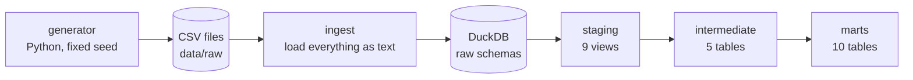
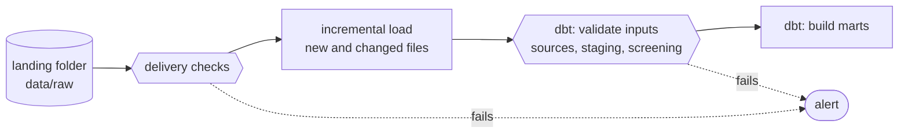
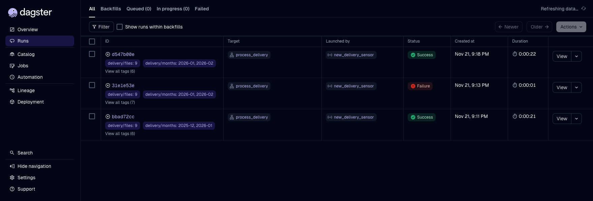
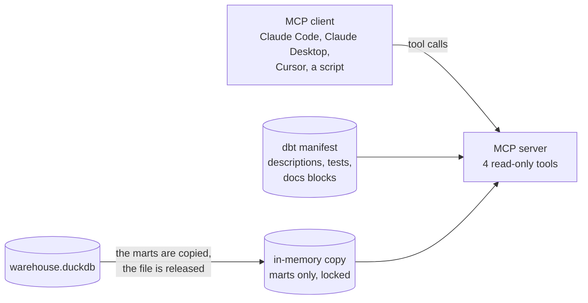

# Retail banking analytics

dbt models over three years of synthetic data from a fictional retail bank, running locally on DuckDB, with a Dagster pipeline that loads each monthly delivery, checks it and raises alerts, and an MCP server that lets a language model answer questions from the marts, with an evaluation of how often it is right.

The project answers three questions a retail banking finance team asks every month:

1. Where does revenue come from, by product and sales channel?
2. What is a customer worth over their lifetime, and does acquisition pay back?
3. Is revenue on plan?

All data is synthetic. A Python generator creates the customers, accounts, transactions, fees and balances, then corrupts part of them on purpose so the tests have real problems to catch. No real customer, account or institution is represented.

## Run it

You need [uv](https://docs.astral.sh/uv/) and `make`. uv installs the right Python version by itself.

```bash
make build
```

That one command installs the pinned dependencies, generates the source files, loads them into a local DuckDB file and runs `dbt build`: 24 models, 145 data tests and 8 unit tests. Once the dependencies are downloaded it takes about 15 seconds on a laptop, and it needs no account or credential.

To look at the results:

```bash
cd transform
uv run dbt show --select customer_lifetime_value --limit 10
```

`make docs` builds and serves the dbt documentation site, with the lineage graph and a description of every table and column. `make test` runs the tests of the generator and the loader.

To see the pipeline process a month as it arrives, and stop a broken one:

```bash
make demo-new-month
make demo-broken-month
```

The [Orchestration](#orchestration) section explains what these do.

To ask the marts questions through the MCP server, and see what it refuses:

```bash
make demo-assistant
```

The [Questions in plain language](#questions-in-plain-language) section explains the server and its evaluation.

## What it answers

The figures below come from the default dataset (seed 42): 4,960 customers acquired between January 2023 and December 2025, 7,148 accounts and 1.17 million transactions. Amounts are in US dollars.

### Where does revenue come from?

`revenue_by_product_channel` has one row per month, product and sales channel. Revenue is split into its three sources: net interest income, fees and card interchange.

Revenue in 2025 by product:

| Product | Net interest income | Fees | Interchange | Total |
| --- | ---: | ---: | ---: | ---: |
| Personal Loan | 600,753 | 146,816 | 0 | 747,569 |
| Classic Credit Card | 287,247 | 19,480 | 201,787 | 508,514 |
| Everyday Checking | 176,966 | 79,517 | 33,429 | 289,912 |
| Premium Credit Card | 46,598 | 14,260 | 64,706 | 125,564 |
| High-Yield Savings | 53,835 | 0 | 0 | 53,835 |

Revenue is attributed to the channel that sold the account. Interest and monthly fees have no transaction channel, so attributing by the channel of each transaction would leave most revenue unassigned.

### What is a customer worth?

`customer_lifetime_value` has one row per acquisition cohort (month) and acquisition channel. It compares the 60-month lifetime value of a customer with what it cost to acquire them.

All cohorts together, by acquisition channel (rounded to whole dollars, so the two parts can differ from the total by one):

| Channel | Customers | CAC | Realized CLV | Projected CLV | CLV (60 months) | CLV to CAC |
| --- | ---: | ---: | ---: | ---: | ---: | ---: |
| Branch | 1,274 | 320 | 621 | 863 | 1,484 | 4.6 |
| Online | 983 | 149 | 421 | 658 | 1,079 | 7.2 |
| Mobile app | 1,697 | 112 | 236 | 610 | 847 | 7.5 |
| Partner | 673 | 195 | 331 | 439 | 771 | 3.9 |
| Call center | 333 | 223 | 285 | 428 | 714 | 3.2 |

Branch customers are worth the most and cost the most to acquire. Mobile and online customers are worth less each but return more per dollar spent to acquire them, and their cohorts pay back sooner: a median of 7 months, against 10.5 for branch. Partner and call center have the lowest ratios.

`customer_lifetime_value_curve` holds the month-by-month curve behind each row, for charting how value builds up with age and for comparing cohorts at the same age.

### Is revenue on plan?

`budget_vs_actual` joins the finance team's revenue plan to actual revenue by month, product and sales channel, with the variance for the month and for the year to date.

2025 by product:

| Product | Budget | Actual | Variance | Variance % |
| --- | ---: | ---: | ---: | ---: |
| Classic Credit Card | 570,135 | 508,514 | -61,621 | -10.8% |
| Everyday Checking | 321,423 | 289,912 | -31,511 | -9.8% |
| Personal Loan | 825,450 | 747,569 | -77,881 | -9.4% |
| Premium Credit Card | 116,604 | 125,564 | 8,960 | 7.7% |
| High-Yield Savings | 49,456 | 53,835 | 4,379 | 8.9% |

Each line is also classified as on plan (within 5% of budget), above plan, below plan, unbudgeted or without actuals. A line keeps a row in months when it has neither budget nor revenue, so the year-to-date columns can be summed across lines for any month.

## How it works



The generator writes files the way source systems would deliver them: full snapshots for customers and accounts, one file per month for transactions, fees and balances, and yearly files from finance. The loader puts every column into DuckDB as text, so a malformed value never breaks the load and all typing happens in dbt.

The dbt project has three layers.

Staging has one model per source table. It casts types, parses dates, removes repeated records and maps inconsistent labels to standard values. Nothing is filtered out.

Intermediate screens transactions and fees against the accounts table and marks each record as usable or rejected, with the reason. It then builds the revenue and cost components per account and month: net interest income after funds transfer pricing, fee revenue, interchange, credit losses and transaction costs.

Marts hold the dimensional core and the finance outputs:

| Model | One row per | Purpose |
| --- | --- | --- |
| `dim_customers` | customer | Cohort, acquisition channel, segment, status |
| `dim_accounts` | account | Product, sales channel, rate, status |
| `dim_products` | product | Pricing attributes and servicing cost |
| `fct_account_monthly_profitability` | account and month | Revenue, credit losses, cost to serve, contribution margin |
| `fct_customer_monthly_profitability` | customer and active month | The same measures per customer, with months since acquisition |
| `revenue_by_product_channel` | month, product, sales channel | Revenue by source |
| `budget_vs_actual` | month, product, sales channel | Plan, actual, variance |
| `customer_lifetime_value` | cohort month and channel | CLV, CAC, ratio, payback |
| `customer_lifetime_value_curve` | cohort month, channel, month of age | Retention and value by age, realized and projected |
| `dq_rejected_records` | source, month, rejection reason | Records the pipeline refused to use |

Money is rounded once, at the account and month grain. Every figure in the finance marts is a sum of those rows, so the reconciliation tests compare totals for exact equality.

## How lifetime value is calculated

Customer lifetime value (CLV, also written LTV) is the present value of the contribution margin an acquired customer is expected to generate over a fixed horizon. In banking LTV more often means loan-to-value, so the models spell the name out.

Contribution margin is revenue minus credit losses minus cost to serve. Revenue is net interest income after funds transfer pricing, plus fees the bank kept, plus card interchange. Cost to serve is a fixed monthly cost per open account plus a unit cost per transaction that depends on the channel: a branch transaction costs far more than a mobile one.

For each cohort and acquisition channel:

1. Months the cohort has already lived use its actual margin.
2. The remaining months, up to month 60, are projected as customers still active times margin per active customer. Both come from what older cohorts showed at the same age. Beyond 24 months too few cohorts are old enough to give stable numbers by age, so those ages share one pooled retention rate and one pooled margin.
3. A channel's own history is blended with the history of all channels, in proportion to how much history the channel has. Credit losses get a much heavier blend than retention and margin before losses, because charge-offs are rare and large. Without it, the two defaults in the 271 customer-months the call center has beyond two years would project a negative margin for every call center cohort.
4. Each month is discounted at 10% a year back to the acquisition month.
5. The total is divided by the customers acquired, so churn lowers the value.

Acquisition cost is kept out of CLV and reported next to it, with the CLV to CAC ratio and the payback month.

Limits worth knowing before using the number:

- With three years of history no cohort has lived months 37 to 60, so that part of every curve is an assumption. `is_projected` and `projected_clv` keep it apart from what was observed.
- The projection ignores calendar effects such as a change in interest rates.
- Projected credit losses lean on all channels together, so the projected part understates differences in credit risk between channels. The realized part carries each channel's actual losses.
- Margin excludes cost of capital, taxes and fixed overhead, which is one reason the CLV to CAC ratios look high.
- Fees count in the month they are charged, including loan origination fees. Accrual accounting would spread an origination fee over the life of the loan, so first-month margin is higher here and payback is shorter.
- The fictional cards have no rewards program, so interchange has no rewards cost against it.
- Horizon, discount rate, the 24-month cutoff and the two blending constants are dbt variables in `transform/dbt_project.yml`.

## Data quality

The generator injects the problems below and counts each one. The counts are for the default dataset.

| Problem in the source | Records | What the pipeline does |
| --- | ---: | --- |
| Channel spelled inconsistently ("Mobile App", "BR", "point of sale") | 47,101 | Mapped to a standard value through a seed |
| Transaction date in US format (03/17/2024) | 11,687 | Parsed in staging |
| Transaction delivered twice | 4,733 | Deduplicated in staging |
| Amount sent with a minus sign | 2,351 | Sign dropped in staging |
| Transaction dated before the account was opened | 1,165 | Rejected |
| Transaction without an amount | 1,150 | Rejected |
| Transaction for an account that does not exist | 1,145 | Rejected |
| Implausibly large amount | 251 | Rejected |
| Fee type sent as a label ("Late Payment") | 238 | Standardized in staging |
| Balance row delivered twice | 180 | Deduplicated in staging |
| Customer segment with inconsistent casing or spacing | 104 | Standardized in staging |
| Fee delivered twice | 76 | Deduplicated in staging |
| Customer without a segment | 46 | Labeled `unassigned` |
| Fee without an amount | 25 | Rejected |
| Fee for an account that does not exist | 25 | Rejected |
| Customer row delivered twice | 10 | Deduplicated in staging |

Two more behaviors are modeled without being errors. About 0.5% of transactions post 3 to 12 days late, so a monthly file can carry records dated in the previous month. A fee charged for such a transaction has no transaction reference until it posts, so the next delivery sends that month's fees file again with the reference filled in. A few customers are internal test accounts and are left out of the marts.

Rejected records are kept, each with its reason, and summarized in `dq_rejected_records`. On the default dataset that mart reports exactly the counts above.

### Testing

Tests are placed by layer.

- On the sources, the eight tests that measure the known problems (duplicates, missing amounts, broken references) run with `severity: warn`, so they report a count without stopping the build. The other source tests fail it.
- On staging, intermediate and marts, tests fail the build: keys, relationships, accepted values, and a check that no channel label is left unmapped.
- Seven singular tests reconcile models with each other, for example that revenue by product and channel equals the account-level fact every month, and that every account has a balance row for each month it was open.
- Eight unit tests cover the logic most likely to break: date and sign cleaning, the order of the rejection rules, which fees count as revenue, net interest income for assets and liabilities, budget variance statuses and year-to-date carry-forward, and three scenarios of the lifetime value projection.
- The four finance marts have enforced contracts, so a changed column name or type fails the build.

The tests were checked against broken data. A copy of the dataset was damaged in five ways: a channel label missing from the mapping, a monthly balance file missing from the middle of the history, the latest balance file missing, a month without a funds transfer rate and a repeated budget line. Each one failed the build at the expected test.

A GitHub Actions workflow (`.github/workflows/ci.yml`) runs on every push and pull request. One job runs the linter, the generator and loader tests and the full build. A second job runs the orchestration tests and both demos described below. A third job runs the tests of the MCP server, its demo and the free part of its evaluation.

## Orchestration

A Dagster pipeline runs the same steps as `make build`, one delivery at a time. When the source systems leave a new month in `data/raw`, it checks the files, loads only what is new, validates the data with dbt and rebuilds the marts. When a check fails, the run stops, the finance marts keep their last good state and an alert is raised.



### Run the pipeline

You need the same tools as before, [uv](https://docs.astral.sh/uv/) and `make`. The first command also installs Dagster, which `make build` does not need.

```bash
make demo-new-month
```

With an empty `data/raw`, this generates the three years of history and runs the pipeline on them: 118 files, loaded and built in one run. Then the source systems deliver January 2026 and the pipeline runs again:

```
2026-01 arrives
---------------
Delivery: 5 new files for 2026-01 and 4 files delivered again with changes
Run b75a7d4e succeeded in 21 seconds
  check the delivery    succeeded
  load the raw tables   succeeded
  dbt: validate inputs  succeeded
  source freshness      succeeded
  dbt: build marts      succeeded
  rejection rate drift  succeeded
Checks: 154 passed, 6 warned, 0 failed
Alerts: none

Loaded 9 of the 123 files in the landing folder. The marts went from 2025-12 to 2026-01.
```

The five new files are the three monthly extracts and the two finance files for 2026. The four delivered again are the two snapshots, the funds transfer rates and December's fees with their late references.

The six warnings are dbt source tests that count known problems; they warn on every run and raise no alert. Dagster shows 143 of the 145 dbt tests as checks. The other two compare one source table with another, which cannot be attached to a single asset; dbt still runs them in the first step, as warnings.

```bash
make demo-broken-month
```

This delivers the following month four times. Each time the demo states what should happen and exits with an error if it does not, so it doubles as an end-to-end test.

| The source sends February 2026 with | What the pipeline does | Marts |
| --- | --- | --- |
| The transactions file cut in half: 37,889 rows where the control file declares 75,779 | Stops before the load, in about a second. Nothing enters the warehouse. Error alert | Stay at January |
| The complete file, with 1 in 20 transactions pointing to accounts that do not exist | Loads the file as sent and builds `dq_rejected_records`, which shows 5.1% of the month rejected. The 1% limit fails, so the marts are not rebuilt. Error alert | Stay at January |
| The file again, with 1 in 200 transactions wrong | Passes the limit and publishes the month. Warning alert: 0.58% rejected is 5.5 times the average of the previous six months | Reach February |
| The corrected file | Loads only that file, which replaces its own rows. No alert | Reach February |

Both demos can be repeated. Each run delivers the month after the latest one in `data/raw`. `make build` goes back to the default three years.

```bash
make orchestrate
```

This starts Dagster at http://localhost:3000 with the asset graph, every check and the history of the runs above. A sensor looks at `data/raw` every 30 seconds and starts a run when it finds files that are not loaded. To watch it, deliver a month from another terminal while Dagster is running:

```bash
uv run python -m generator --end-month 2026-03
```

The three runs below were started by the sensor: a new month, a truncated delivery that failed in one second, and the corrected delivery.



`make pipeline` does once, without the UI, what the sensor does: it processes whatever is in `data/raw` and prints the same report as the demos.

### What is checked

| When | Check | If it fails |
| --- | --- | --- |
| Before the load | The files on disk are the ones the control file lists, and every month has all its monthly files | Run stops, nothing is loaded |
| Before the load | Every new file has the columns its feed promises | Run stops, nothing is loaded |
| Before the load | Every new file has the row count the source declared in the control file | Run stops, nothing is loaded |
| Before the load | A new monthly file is between half and double the average of the three months before it | Warning |
| After the load | Every file has as many rows in its raw table as it has on disk | Run stops before dbt |
| After the load | `dbt source freshness`: the monthly feeds were loaded in the last 35 days | Warning, error after 45 days |
| dbt, first step | The 98 tests on sources, staging, record screening and `dq_rejected_records`, among them the 1% limit on any rejection reason | Run stops, marts are not rebuilt |
| After the first step | No rejection reason in the months just loaded runs at more than three times its average of the previous six months | Warning |
| dbt, second step | The 47 tests on the remaining intermediate models and the marts | Run fails |

The control file is `data/raw/_manifest.json`, written by the generator the way a source system sends a control file with a batch: the list of files and the number of records in each. It catches a file damaged on the way. The volume check catches the case the control file cannot: a source that sent a partial extract and counted it correctly. The load accepts only the exact files that passed these checks in the same run: if a file changes between the check and the load, nothing is loaded.

`dbt build` is split in two so that validation finishes before any mart is replaced. The first step builds everything that reads the raw tables and judges their quality, including the rejected-records report, which is the first thing to look at when a delivery is stopped. The second step builds the rest. A failure in the second step is a bug in a model, not a problem with the delivery: it fails the run and raises an alert, and dbt skips whatever is downstream of the failed test.

dbt tests say what must always be true of the warehouse. The freshness and drift checks need to know about time and about the delivery at hand, so they live in the orchestrator. Freshness also runs on a daily schedule, to notice the case where nothing arrives and so nothing runs.

### Alerts

An error means the run stopped and somebody has to act. A warning means the run went on and somebody should look. dbt tests with `severity: warn` raise no alert: they count source problems the staging models already repair or reject, so they warn on every run by design. The drift check is what notices when one of those counts changes.

Alerts are written to `data/alerts/alerts.jsonl`, one JSON object per line, which needs no account and no secret:

```json
{
  "alert_id": "347967ba0183",
  "raised_at": "2026-11-22T00:45:31Z",
  "severity": "error",
  "source": "landing/delivery: row_counts_match_control_file",
  "summary": "Row count differs from the control file: core_banking/transactions/transactions_2026-02.csv: control file says 75,779 rows, the file has 37,889",
  "problems": ["core_banking/transactions/transactions_2026-02.csv: control file says 75,779 rows, the file has 37,889"],
  "job": "process_delivery",
  "run_id": "7d307dbf-2eb6-4cb6-b494-426c943268b8"
}
```

To send them to a chat tool as well, set `ALERT_WEBHOOK_URL` in the environment before starting the pipeline. Each new alert is posted there as `{"text": "..."}`, the format Slack incoming webhooks accept. A run is evaluated once: looking at the same run again never repeats an alert.

When a dbt test fails, the alert carries the explanation written in the dbt project: the test's description, or the comment that opens a singular test and says where to look.

### How the load works

`ingest/load_raw.py` keeps a ledger, `raw_meta.loaded_files`, with the content hash and row count of every file it has loaded. A file is loaded when it is not in the ledger or its hash changed, and a file loaded again replaces its own rows, all in one transaction. Running the pipeline twice changes nothing, and a corrected file needs no special handling. `make build` still replaces the raw tables from scratch.

Only the raw layer is incremental. dbt rebuilds every model on each run: it takes seconds at this volume, and because transactions arrive late and files are restated, a rebuild is the simple way to stay correct.

## Questions in plain language

An MCP server lets a language model answer business questions from the marts and their dbt documentation, and from nothing else. An evaluation measures how often the answers are right.

The [Model Context Protocol](https://modelcontextprotocol.io) (MCP) is the standard way to hand tools to a language model. dbt Labs maintains [an official MCP server](https://github.com/dbt-labs/dbt-mcp), and for a team on the dbt platform that is the one to use. The server here is small on purpose. It shows two things the official one leaves to whoever runs it:

- **A fence.** Run locally without a dbt platform account, the official server offers the dbt commands (checked against its documentation in November 2026). `show` runs any SQL with the credentials dbt itself writes with, and `build` and `run` change the warehouse. Its read-only query tool, its documentation tools and its metrics tools need the platform. Here the model can read the ten marts and can reach nothing else, because nothing else is there.
- **A measurement.** 44 questions with reference answers computed from the warehouse, graded by a program, so "the model answers correctly" is a number with a method behind it.



### Try it

You need the same tools as before, [uv](https://docs.astral.sh/uv/) and `make`. The first command also installs the MCP SDK, and builds the warehouse if there is none.

```bash
make demo-assistant
```

There is no language model in this demo, so it needs no account and no key. A script plays the client: it makes the tool calls a model would make, through the real protocol, to a server it launches. It asks four questions and tries three things the server must refuse. Every figure is compared with a direct read of the warehouse file, and the demo exits with an error if one differs or if a refusal does not happen.

```
2. What is a customer worth, by acquisition channel?
----------------------------------------------------
describe_model customer_lifetime_value -> "To aggregate cohorts or channels, sum the totals (`realized_discounted_margin`, `projected_discounted_margin`, `acquisition_spend`, `customers_acquired`) and divide; do not average the per-customer columns."
search_docs -> definition customer_lifetime_value: "It does not subtract acquisition cost."
run_query
    SELECT acquisition_channel,
           sum(customers_acquired) AS customers,
           sum(acquisition_spend) / sum(customers_acquired) AS cac,
           sum(realized_discounted_margin + projected_discounted_margin)
               / sum(customers_acquired) AS clv,
           sum(realized_discounted_margin + projected_discounted_margin)
               / sum(acquisition_spend) AS clv_to_cac
    FROM marts.customer_lifetime_value
    GROUP BY acquisition_channel
    ORDER BY clv DESC

  Channel      Customers  CAC  CLV (60 months)  CLV to CAC
  branch           1,274  320            1,484         4.6
  online             983  149            1,079         7.2
  mobile_app       1,697  112              847         7.5
  partner            673  195              771         3.9
  call_center        333  223              714         3.2

What the server refuses
-----------------------
Read a raw table
    SELECT * FROM raw_core_banking.transactions LIMIT 5
    refused: Catalog Error: Table with name "raw_core_banking.transactions" does not exist because schema "raw_core_banking" does not exist.
Change the data
    DELETE FROM marts.dim_customers
    refused: Only SELECT statements are allowed, and this is a DELETE statement.
Read a file from disk
    SELECT * FROM read_csv('data/raw/core_banking/customers/customers.csv')
    refused: Reading files, attaching databases and loading extensions are disabled.

The 4 query results matched a direct read of the warehouse file, and the 3 statements were refused.
```

### Connect a client

An MCP client launches the server itself, over standard input and output. Claude Code, Claude Desktop and Cursor all read the same block of configuration. Replace the path with the folder of your clone:

```json
{
  "mcpServers": {
    "retail-banking": {
      "command": "uv",
      "args": [
        "run", "--directory", "/absolute/path/to/retail-banking-analytics",
        "--group", "assistant", "python", "-m", "assistant"
      ]
    }
  }
}
```

For a client that connects to an address instead, start the server over HTTP. It listens on this machine only, at http://127.0.0.1:8765/mcp, and has no authentication, so it is for local use.

```bash
make assistant
```

This was checked with Claude Code 2.1.327 running Claude Sonnet 5.5, with that configuration in a file passed as `--mcp-config` and every built-in tool switched off, so the server was the model's only source. Claude Desktop and Cursor were not tested. Asked "Which acquisition channel returns the most customer lifetime value per dollar of acquisition cost, all cohorts together, and what is the ratio?", it called `list_models`, `search_docs`, `describe_model` and `run_query`, summed the totals before dividing, as the documentation says, and answered:

> Mobile app returns the most lifetime value per acquisition dollar across all cohorts, at about 7.5 dollars of CLV per dollar spent ($1.44M of discounted margin on $190K of spend). Online is close behind at about 7.2, and the other three channels are lower: branch at 4.6, partner at 3.9 and call center at 3.2.
>
> This ratio includes projected margin for months not yet lived. Counting only realized margin, online comes out ahead of mobile app (2.8 against 2.1).

Asked how many transactions were made at ATMs in 2025, it looked through the tables and answered that the marts hold transaction counts per account and month with no split by channel, and that it would not estimate. Three questions show that a client connects and how the server reads to a model. They are not an evaluation. That is the [Evaluation](#evaluation) section below.

### The tools

| Tool | What it returns |
| --- | --- |
| `list_models` | The ten marts, what one row of each is, and the period the data covers |
| `describe_model` | The columns of a mart: type, description, accepted values, and how each may be aggregated |
| `search_docs` | Business definitions from the dbt docs blocks, and matching descriptions of models and columns |
| `run_query` | The rows of one `SELECT` over the marts, 500 at most |

The descriptions are the ones written in the dbt project, read from its manifest. Nothing about the data is written a second time for the model. A column's accepted values and its `unique` and `not_null` marks come from its dbt tests. Upstream models can be found in `search_docs`, marked as documentation only.

### What a query can reach

The server never runs a query against the warehouse file. When it starts, and again whenever the file has changed, it copies the ten marts into an in-memory DuckDB database and releases the file. Three things then stand between a query and everything else:

1. **The raw, staging and intermediate tables are not in the copy.** A query that names one fails because the table does not exist, whatever else the query says.
2. **The copy cannot reach outside itself.** File access, `ATTACH`, `COPY` and extensions are switched off in DuckDB (`enable_external_access = false`), and the configuration is locked so the switch cannot be turned back on.
3. **One statement per call, and it has to be a `SELECT`.** The statement is classified by DuckDB's own parser, the one that then runs it, so there is no second parser to disagree with.

The tests try each one: thirteen kinds of statement that are not a `SELECT`, two statements in one call, four ways of reading a file from a `SELECT`, and the raw and staging tables by name. One test skips the statement check on purpose and confirms that the engine still refuses. A query is stopped after 15 seconds, and the copy is limited to 1 GB of memory.

These are tests, not a security review. A `SELECT` can still call any function built into DuckDB, and what it can read that way is the server's own settings and the catalog of the copy.

### Next to the pipeline

DuckDB lets one process write to a file or several read it, never both. A server that kept the warehouse open would make `make build` and the Dagster pipeline fail, and a server that opened it per query would fail while they run.

The copy solves both. The server holds the file only while it copies, about 40 milliseconds for this dataset on a laptop. While the pipeline is writing, it keeps answering from the last copy and says so with the results: "The warehouse is being written by the pipeline. These figures come from the copy made at 2026-11-22 16:47 UTC and may be one load behind." It also leaves alone a file that changed in the last 30 seconds, because the pipeline writes in several steps and releases the file between them. Data that arrives once a month can wait half a minute. Two tests hold the file open for writing from another process to check this, and a third checks that another process can open the file for writing while the server is up.

One risk is left. During those 40 milliseconds the server holds the file, and a pipeline step that tried to open it in that same instant would fail. Waiting for 30 quiet seconds makes that a coincidence of two unlikely things, and in a run of the orchestrated pipeline with the server being queried twice a second the whole time, it did not happen: the pipeline finished, the server answered every call from its last copy, and showed the new month once the file had been quiet.

### Evaluation

The evaluation asks a model 44 questions through the server and grades the answers.

| Kind | Questions | Example | What it catches |
| --- | ---: | --- | --- |
| lookup | 16 | What revenue was budgeted for the Personal Loan product in 2025? | Finding the right mart, column and filter |
| aggregation | 11 | Taking every acquisition cohort and channel together, what is the 60-month customer lifetime value per acquired customer? | A plausible query that gives another number: here, averaging the per-cohort figure gives 975 where the answer is 1,037 |
| definition | 8 | Do fees that were waived count as fee revenue? | Reading the documentation instead of assuming |
| unanswerable | 9 | How many transactions were made at ATMs in 2025? | Inventing a figure. The right answer is that the marts cannot say |

The questions are in [`assistant/evals/questions.yml`](assistant/evals/questions.yml), each with what it is there to catch.

**The answer key is computed, not typed.** Each question that has a figure for an answer carries the SQL that produces it, and the key is the result of running that SQL through the same fenced path the server uses. Six answers are confirmed by a second query through other tables. Each of the eleven aggregation questions also carries the plausible wrong query, and the evaluation checks that its result is graded as wrong: that is what proves a question can tell the two apart, including the one where the wrong answer is four dollars away. The key for the default dataset is committed, so a change to a model that moves an answer fails the check.

**Answers are graded by a program.** The model hands in its answer through one tool call of a fixed shape: a number, a label, yes or no, or a breakdown, or the statement that the question cannot be answered. An amount in dollars is correct within a dollar, a percentage within its last decimal, and a count only when exact. There is no second model judging the first. A question ends in one of four ways:

| Outcome | Meaning |
| --- | --- |
| correct | The right answer, or "cannot be answered" for an unanswerable question |
| wrong answer | An answer that is not right. This is the outcome that misleads someone |
| said it cannot answer | For a question that can be answered. No harm done, and no help |
| no answer | The model stopped without handing in an answer |

**Two servers are compared.** The model answers every question twice: through the server as it is, and through the same server started with `--no-docs`, which returns table and column names and types with no description, no accepted values and no `search_docs`. The difference is what the dbt documentation is worth to a model on these questions.

```bash
make eval
```

This part is free and calls no model. It computes the answer key from the warehouse, runs the second queries and the wrong queries, compares the key with the committed one, and scores three answer sheets whose result is known in advance:

```
The questions
-------------
44 questions: 16 lookup, 11 aggregation, 8 definition, 9 unanswerable

The answer key
--------------
27 reference answers computed from the warehouse, one SELECT over the marts each
8 reference answers stated by the documentation
6 confirmed by a second query
11 plausible wrong queries graded as wrong
Equal to the answer key committed for the default dataset

The grader
----------
Handing in the reference answers: 44 of 44 correct
Always saying "cannot be answered": 9 of 44 correct
Always answering zero, "no" or "unknown": 2 of 44 correct
```

Then it regrades every recorded run from the answers stored in the repository and prints the tables below, so the published figures can be checked without paying for a model.

```bash
export ANTHROPIC_API_KEY=...
make eval-live
```

This part calls a model, Claude Opus 5.5 unless another is named, and costs money. It needs an Anthropic API key in the environment, and nothing else in the repository uses one. `ARGS` passes options: `make eval-live ARGS="--model claude-haiku-5-5 --repetitions 3 --max-usd 5"`. The run stops starting questions when its estimated cost reaches `--max-usd` (2 dollars by default), writes each answer as it arrives, and picks up where it stopped when the command is run again. Every tool call goes through the MCP protocol to a real server process.

### Results

No model run is recorded yet.

### Limits of the evaluation

- The questions were written by the person who wrote the models and their documentation. They ask for what the marts were built to answer, in the marts' own vocabulary. People ask vaguer questions.
- Every question states its unit, its precision and its period. A real question rarely does, and choosing them is part of the work.
- The answer key is SQL written by the same person. A second query confirms six of the answers. A wrong reference query would count against the model.
- The grader checks the answer and not the explanation. A right number with a misleading sentence around it passes.
- Four questions are yes or no, so a guess is right half the time on those.
- The model works under the evaluation's own short instructions and hands in a structured answer. A chat client adds instructions of its own and returns prose.
- 44 questions on one synthetic dataset, in English. The interval printed next to each result says how much it would move with another draw of questions of the same kind. A difference smaller than that interval is not a finding.
- The names of the tables and columns are already descriptive. Removing the descriptions from a warehouse with cryptic names would cost a model more than it does here, so the comparison understates what documentation is worth.
- A result belongs to one model on one date. The cost is an estimate from token counts and the list prices of November 2026.

## Design choices

DuckDB keeps the project free to run and easy to clone: the warehouse is one local file and there is nothing to sign up for. The sources are ordinary tables in raw schemas, as they would be in a cloud warehouse.

The generator is deterministic. The same seed always produces the same files. Extending the end month adds new monthly files and leaves the transactions and balances of earlier months as they were. The snapshots (customers, accounts, funds transfer rates) and the current year's finance files are replaced, and the latest fees file is sent again with a few references completed. That makes results reproducible and lets the pipeline load one new month at a time.

Reference data that changes rarely and is maintained by hand lives in dbt seeds: the channel mapping and the unit costs used for cost to serve.

Dagster was chosen as the orchestrator because it reads the dbt project directly: every model becomes an asset and its tests become checks, with no code to keep in sync. It also runs from the same environment as dbt with one command and no service to set up.

The unit of work is a delivery, not a monthly partition. A delivery is whatever is in the landing folder and not yet loaded, tracked file by file in the ledger. The first load of three years and the arrival of one month go through the same job, and a month does not have to arrive alone or on time.

The sensor waits for the control file, which the generator writes last, so it never picks up a delivery that is still being written. Each run is keyed by the content of the files it would load. A delivery that failed its checks is not retried every 30 seconds; it runs again when one of its files changes.

Runs are queued one at a time and their steps execute in a single process, because DuckDB accepts one writing process at a time.

The MCP server is written for this project instead of configuring a general one, so that what a model may read is decided by what the server holds, not by a setting someone has to remember. It serves a copy of the marts and not the warehouse for the same reason, and the copy is also what lets it run next to the pipeline.

The evaluation has no model as a judge. Every answer is a figure, a label or a yes, so a program can grade it, the grade is the same on every run, and anyone can recompute it from the recorded answers. The price is that only questions with one right answer can be asked.

The loop that lets a model answer is one short function over the Messages API, with no agent framework, because an evaluation has to record every tool call and every token, and has to know which model answered.

## Project structure

```
generator/     synthetic data generator and its tests
ingest/        loads the CSV files into DuckDB as text
  contract.py        what each feed delivers: cadence, file names, columns
  delivery.py        what is new in the landing folder, and the checks on it
  ledger.py          record of every file loaded
  load_raw.py        full refresh and incremental load
orchestration/ Dagster project
  assets.py          delivery, raw tables and the two dbt steps
  checks.py          source freshness and rejection rate drift
  alerts.py          what raises an alert and where it goes
  automation.py      jobs, the delivery sensor, the alert sensors, the schedule
  run_once.py        one pipeline run without the UI
  demo.py            the two demos
assistant/     MCP server and its evaluation
  catalog.py         the dbt documentation, read from the manifest
  warehouse.py       the locked, in-memory copy of the marts and the SELECT-only check
  server.py          the four tools
  demo.py            the scripted client
  evals/
    questions.yml    the 44 questions, with the SQL that answers each one
    answer_key.py    reference answers computed from the warehouse, and their checks
    grading.py       the grader and the intervals
    agent.py         the loop a model answers through
    runs.py          recorded runs and their summary
    results/         answers of the recorded runs
transform/     dbt project
  models/
    staging/         one model per source table
    intermediate/    record screening, revenue and cost components
    marts/           core dimensions and facts, finance outputs, data quality
  seeds/       channel mapping and unit costs
  macros/      cleaning helpers and schema naming
  tests/       singular tests
data/          generated files, the local warehouse, run history and alerts (not committed)
```

Generator options, for a larger dataset or a different period:

```bash
uv run python -m generator --help
```

## Next steps

- Run the same questions through the official dbt MCP server, limited to its `show` tool, as a third column of the evaluation.
- Add questions phrased the way people ask them, without unit, precision or period, and grade whether the model asks or assumes.

## License

MIT. See [LICENSE](LICENSE).
