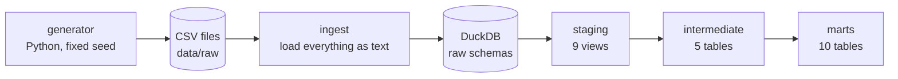

# Retail banking analytics

dbt models over three years of synthetic data from a fictional retail bank, running locally on DuckDB.

The project answers three questions a retail banking finance team asks every month:

1. Where does revenue come from, by product and sales channel?
2. What is a customer worth over their lifetime, and does acquisition pay back?
3. Is revenue on plan?

All data is synthetic. A Python generator creates the customers, accounts, transactions, fees and balances, then corrupts part of them on purpose so the tests have real problems to catch. No real customer, account or institution is represented.

## Run it

You need [uv](https://docs.astral.sh/uv/) and `make`. uv installs the right Python version by itself.

```bash
make build
```

That one command installs the pinned dependencies, generates the source files, loads them into a local DuckDB file and runs `dbt build`: 24 models, 145 data tests and 8 unit tests. Once the dependencies are downloaded it takes about 15 seconds on a laptop, and it needs no account or credential.

To look at the results:

```bash
cd transform
uv run dbt show --select customer_lifetime_value --limit 10
```

`make docs` builds and serves the dbt documentation site, with the lineage graph and a description of every table and column. `make test` runs the generator's own tests.

## What it answers

The figures below come from the default dataset (seed 42): 4,960 customers acquired between January 2023 and December 2025, 7,148 accounts and 1.17 million transactions. Amounts are in US dollars.

### Where does revenue come from?

`revenue_by_product_channel` has one row per month, product and sales channel. Revenue is split into its three sources: net interest income, fees and card interchange.

Revenue in 2025 by product:

| Product | Net interest income | Fees | Interchange | Total |
| --- | ---: | ---: | ---: | ---: |
| Personal Loan | 600,753 | 146,816 | 0 | 747,569 |
| Classic Credit Card | 287,247 | 19,480 | 201,787 | 508,514 |
| Everyday Checking | 176,966 | 79,517 | 33,429 | 289,912 |
| Premium Credit Card | 46,598 | 14,260 | 64,706 | 125,564 |
| High-Yield Savings | 53,835 | 0 | 0 | 53,835 |

Revenue is attributed to the channel that sold the account. Interest and monthly fees have no transaction channel, so attributing by the channel of each transaction would leave most revenue unassigned.

### What is a customer worth?

`customer_lifetime_value` has one row per acquisition cohort (month) and acquisition channel. It compares the 60-month lifetime value of a customer with what it cost to acquire them.

All cohorts together, by acquisition channel (rounded to whole dollars, so the two parts can differ from the total by one):

| Channel | Customers | CAC | Realized CLV | Projected CLV | CLV (60 months) | CLV to CAC |
| --- | ---: | ---: | ---: | ---: | ---: | ---: |
| Branch | 1,274 | 320 | 621 | 863 | 1,484 | 4.6 |
| Online | 983 | 149 | 421 | 658 | 1,079 | 7.2 |
| Mobile app | 1,697 | 112 | 236 | 610 | 847 | 7.5 |
| Partner | 673 | 195 | 331 | 439 | 771 | 3.9 |
| Call center | 333 | 223 | 285 | 428 | 714 | 3.2 |

Branch customers are worth the most and cost the most to acquire. Mobile and online customers are worth less each but return more per dollar spent to acquire them, and their cohorts pay back sooner: a median of 7 months, against 10.5 for branch. Partner and call center have the lowest ratios.

`customer_lifetime_value_curve` holds the month-by-month curve behind each row, for charting how value builds up with age and for comparing cohorts at the same age.

### Is revenue on plan?

`budget_vs_actual` joins the finance team's revenue plan to actual revenue by month, product and sales channel, with the variance for the month and for the year to date.

2025 by product:

| Product | Budget | Actual | Variance | Variance % |
| --- | ---: | ---: | ---: | ---: |
| Classic Credit Card | 570,135 | 508,514 | -61,621 | -10.8% |
| Everyday Checking | 321,423 | 289,912 | -31,511 | -9.8% |
| Personal Loan | 825,450 | 747,569 | -77,881 | -9.4% |
| Premium Credit Card | 116,604 | 125,564 | 8,960 | 7.7% |
| High-Yield Savings | 49,456 | 53,835 | 4,379 | 8.9% |

Each line is also classified as on plan (within 5% of budget), above plan, below plan, unbudgeted or without actuals. A line keeps a row in months when it has neither budget nor revenue, so the year-to-date columns can be summed across lines for any month.

## How it works



The generator writes files the way source systems would deliver them: full snapshots for customers and accounts, one file per month for transactions, fees and balances, and yearly files from finance. The loader puts every column into DuckDB as text, so a malformed value never breaks the load and all typing happens in dbt.

The dbt project has three layers.

Staging has one model per source table. It casts types, parses dates, removes repeated records and maps inconsistent labels to standard values. Nothing is filtered out.

Intermediate screens transactions and fees against the accounts table and marks each record as usable or rejected, with the reason. It then builds the revenue and cost components per account and month: net interest income after funds transfer pricing, fee revenue, interchange, credit losses and transaction costs.

Marts hold the dimensional core and the finance outputs:

| Model | One row per | Purpose |
| --- | --- | --- |
| `dim_customers` | customer | Cohort, acquisition channel, segment, status |
| `dim_accounts` | account | Product, sales channel, rate, status |
| `dim_products` | product | Pricing attributes and servicing cost |
| `fct_account_monthly_profitability` | account and month | Revenue, credit losses, cost to serve, contribution margin |
| `fct_customer_monthly_profitability` | customer and active month | The same measures per customer, with months since acquisition |
| `revenue_by_product_channel` | month, product, sales channel | Revenue by source |
| `budget_vs_actual` | month, product, sales channel | Plan, actual, variance |
| `customer_lifetime_value` | cohort month and channel | CLV, CAC, ratio, payback |
| `customer_lifetime_value_curve` | cohort month, channel, month of age | Retention and value by age, realized and projected |
| `dq_rejected_records` | source, month, rejection reason | Records the pipeline refused to use |

Money is rounded once, at the account and month grain. Every figure in the finance marts is a sum of those rows, so the reconciliation tests compare totals for exact equality.

## How lifetime value is calculated

Customer lifetime value (CLV, also written LTV) is the present value of the contribution margin an acquired customer is expected to generate over a fixed horizon. In banking LTV more often means loan-to-value, so the models spell the name out.

Contribution margin is revenue minus credit losses minus cost to serve. Revenue is net interest income after funds transfer pricing, plus fees the bank kept, plus card interchange. Cost to serve is a fixed monthly cost per open account plus a unit cost per transaction that depends on the channel: a branch transaction costs far more than a mobile one.

For each cohort and acquisition channel:

1. Months the cohort has already lived use its actual margin.
2. The remaining months, up to month 60, are projected as customers still active times margin per active customer. Both come from what older cohorts showed at the same age. Beyond 24 months too few cohorts are old enough to give stable numbers by age, so those ages share one pooled retention rate and one pooled margin.
3. A channel's own history is blended with the history of all channels, in proportion to how much history the channel has. Credit losses get a much heavier blend than retention and margin before losses, because charge-offs are rare and large. Without it, the two defaults in the 271 customer-months the call center has beyond two years would project a negative margin for every call center cohort.
4. Each month is discounted at 10% a year back to the acquisition month.
5. The total is divided by the customers acquired, so churn lowers the value.

Acquisition cost is kept out of CLV and reported next to it, with the CLV to CAC ratio and the payback month.

Limits worth knowing before using the number:

- With three years of history no cohort has lived months 37 to 60, so that part of every curve is an assumption. `is_projected` and `projected_clv` keep it apart from what was observed.
- The projection ignores calendar effects such as a change in interest rates.
- Projected credit losses lean on all channels together, so the projected part understates differences in credit risk between channels. The realized part carries each channel's actual losses.
- Margin excludes cost of capital, taxes and fixed overhead, which is one reason the CLV to CAC ratios look high.
- Fees count in the month they are charged, including loan origination fees. Accrual accounting would spread an origination fee over the life of the loan, so first-month margin is higher here and payback is shorter.
- The fictional cards have no rewards program, so interchange has no rewards cost against it.
- Horizon, discount rate, the 24-month cutoff and the two blending constants are dbt variables in `transform/dbt_project.yml`.

## Data quality

The generator injects the problems below and counts each one. The counts are for the default dataset.

| Problem in the source | Records | What the pipeline does |
| --- | ---: | --- |
| Channel spelled inconsistently ("Mobile App", "BR", "point of sale") | 47,101 | Mapped to a standard value through a seed |
| Transaction date in US format (03/17/2024) | 11,687 | Parsed in staging |
| Transaction delivered twice | 4,733 | Deduplicated in staging |
| Amount sent with a minus sign | 2,351 | Sign dropped in staging |
| Transaction dated before the account was opened | 1,165 | Rejected |
| Transaction without an amount | 1,150 | Rejected |
| Transaction for an account that does not exist | 1,145 | Rejected |
| Implausibly large amount | 251 | Rejected |
| Fee type sent as a label ("Late Payment") | 238 | Standardized in staging |
| Balance row delivered twice | 180 | Deduplicated in staging |
| Customer segment with inconsistent casing or spacing | 104 | Standardized in staging |
| Fee delivered twice | 76 | Deduplicated in staging |
| Customer without a segment | 46 | Labeled `unassigned` |
| Fee without an amount | 25 | Rejected |
| Fee for an account that does not exist | 25 | Rejected |
| Customer row delivered twice | 10 | Deduplicated in staging |

Two more behaviors are modeled without being errors. About 0.5% of transactions post 3 to 12 days late, so a monthly file can carry records dated in the previous month. A few customers are internal test accounts and are left out of the marts.

Rejected records are kept, each with its reason, and summarized in `dq_rejected_records`. On the default dataset that mart reports exactly the counts above.

### Testing

Tests are placed by layer.

- On the sources, the eight tests that measure the known problems (duplicates, missing amounts, broken references) run with `severity: warn`, so they report a count without stopping the build. The other source tests fail it.
- On staging, intermediate and marts, tests fail the build: keys, relationships, accepted values, and a check that no channel label is left unmapped.
- Seven singular tests reconcile models with each other, for example that revenue by product and channel equals the account-level fact every month, and that every account has a balance row for each month it was open.
- Eight unit tests cover the logic most likely to break: date and sign cleaning, the order of the rejection rules, which fees count as revenue, net interest income for assets and liabilities, budget variance statuses and year-to-date carry-forward, and three scenarios of the lifetime value projection.
- The four finance marts have enforced contracts, so a changed column name or type fails the build.

The tests were checked against broken data. A copy of the dataset was damaged in five ways: a channel label missing from the mapping, a monthly balance file missing from the middle of the history, the latest balance file missing, a month without a funds transfer rate and a repeated budget line. Each one failed the build at the expected test.

A GitHub Actions workflow (`.github/workflows/ci.yml`) runs the linter, the generator tests and the full build on every push and pull request.

## Design choices

DuckDB keeps the project free to run and easy to clone: the warehouse is one local file and there is nothing to sign up for. The sources are ordinary tables in raw schemas, as they would be in a cloud warehouse.

The generator is deterministic. The same seed always produces the same files. Extending the end month adds new monthly files and leaves the earlier ones as they were; only the customer and account snapshots are replaced, as snapshots are. That makes results reproducible and lets a scheduled run load one new month at a time.

Reference data that changes rarely and is maintained by hand lives in dbt seeds: the channel mapping and the unit costs used for cost to serve.

## Project structure

```
generator/     synthetic data generator and its tests
ingest/        loads the CSV files into DuckDB as text
transform/     dbt project
  models/
    staging/         one model per source table
    intermediate/    record screening, revenue and cost components
    marts/           core dimensions and facts, finance outputs, data quality
  seeds/       channel mapping and unit costs
  macros/      cleaning helpers and schema naming
  tests/       singular tests
data/          generated files and the local warehouse (not committed)
```

Generator options, for a larger dataset or a different period:

```bash
uv run python -m generator --help
```

## Next steps

- Orchestration: scheduled monthly loads with data quality checks and alerting.
- A Model Context Protocol (MCP) server that lets a language model answer questions using only these marts and their documentation, with an evaluation of answer accuracy.

## License

MIT. See [LICENSE](LICENSE).
