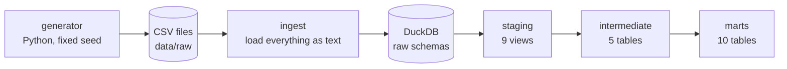

# Retail banking analytics

dbt models over three years of synthetic data from a fictional retail bank, running locally on DuckDB, with a Dagster pipeline that loads each monthly delivery, checks it and raises alerts.

The project answers three questions a retail banking finance team asks every month:

1. Where does revenue come from, by product and sales channel?
2. What is a customer worth over their lifetime, and does acquisition pay back?
3. Is revenue on plan?

All data is synthetic. A Python generator creates the customers, accounts, transactions, fees and balances, then corrupts part of them on purpose so the tests have real problems to catch. No real customer, account or institution is represented.

## Run it

You need [uv](https://docs.astral.sh/uv/) and `make`. uv installs the right Python version by itself.

```bash
make build
```

That one command installs the pinned dependencies, generates the source files, loads them into a local DuckDB file and runs `dbt build`: 24 models, 145 data tests and 8 unit tests. Once the dependencies are downloaded it takes about 15 seconds on a laptop, and it needs no account or credential.

To look at the results:

```bash
cd transform
uv run dbt show --select customer_lifetime_value --limit 10
```

`make docs` builds and serves the dbt documentation site, with the lineage graph and a description of every table and column. `make test` runs the tests of the generator and the loader.

To see the pipeline process a month as it arrives, and stop a broken one:

```bash
make demo-new-month
make demo-broken-month
```

The [Orchestration](#orchestration) section explains what these do.

## What it answers

The figures below come from the default dataset (seed 42): 4,960 customers acquired between January 2023 and December 2025, 7,148 accounts and 1.17 million transactions. Amounts are in US dollars.

### Where does revenue come from?

`revenue_by_product_channel` has one row per month, product and sales channel. Revenue is split into its three sources: net interest income, fees and card interchange.

Revenue in 2025 by product:

| Product | Net interest income | Fees | Interchange | Total |
| --- | ---: | ---: | ---: | ---: |
| Personal Loan | 600,753 | 146,816 | 0 | 747,569 |
| Classic Credit Card | 287,247 | 19,480 | 201,787 | 508,514 |
| Everyday Checking | 176,966 | 79,517 | 33,429 | 289,912 |
| Premium Credit Card | 46,598 | 14,260 | 64,706 | 125,564 |
| High-Yield Savings | 53,835 | 0 | 0 | 53,835 |

Revenue is attributed to the channel that sold the account. Interest and monthly fees have no transaction channel, so attributing by the channel of each transaction would leave most revenue unassigned.

### What is a customer worth?

`customer_lifetime_value` has one row per acquisition cohort (month) and acquisition channel. It compares the 60-month lifetime value of a customer with what it cost to acquire them.

All cohorts together, by acquisition channel (rounded to whole dollars, so the two parts can differ from the total by one):

| Channel | Customers | CAC | Realized CLV | Projected CLV | CLV (60 months) | CLV to CAC |
| --- | ---: | ---: | ---: | ---: | ---: | ---: |
| Branch | 1,274 | 320 | 621 | 863 | 1,484 | 4.6 |
| Online | 983 | 149 | 421 | 658 | 1,079 | 7.2 |
| Mobile app | 1,697 | 112 | 236 | 610 | 847 | 7.5 |
| Partner | 673 | 195 | 331 | 439 | 771 | 3.9 |
| Call center | 333 | 223 | 285 | 428 | 714 | 3.2 |

Branch customers are worth the most and cost the most to acquire. Mobile and online customers are worth less each but return more per dollar spent to acquire them, and their cohorts pay back sooner: a median of 7 months, against 10.5 for branch. Partner and call center have the lowest ratios.

`customer_lifetime_value_curve` holds the month-by-month curve behind each row, for charting how value builds up with age and for comparing cohorts at the same age.

### Is revenue on plan?

`budget_vs_actual` joins the finance team's revenue plan to actual revenue by month, product and sales channel, with the variance for the month and for the year to date.

2025 by product:

| Product | Budget | Actual | Variance | Variance % |
| --- | ---: | ---: | ---: | ---: |
| Classic Credit Card | 570,135 | 508,514 | -61,621 | -10.8% |
| Everyday Checking | 321,423 | 289,912 | -31,511 | -9.8% |
| Personal Loan | 825,450 | 747,569 | -77,881 | -9.4% |
| Premium Credit Card | 116,604 | 125,564 | 8,960 | 7.7% |
| High-Yield Savings | 49,456 | 53,835 | 4,379 | 8.9% |

Each line is also classified as on plan (within 5% of budget), above plan, below plan, unbudgeted or without actuals. A line keeps a row in months when it has neither budget nor revenue, so the year-to-date columns can be summed across lines for any month.

## How it works



The generator writes files the way source systems would deliver them: full snapshots for customers and accounts, one file per month for transactions, fees and balances, and yearly files from finance. The loader puts every column into DuckDB as text, so a malformed value never breaks the load and all typing happens in dbt.

The dbt project has three layers.

Staging has one model per source table. It casts types, parses dates, removes repeated records and maps inconsistent labels to standard values. Nothing is filtered out.

Intermediate screens transactions and fees against the accounts table and marks each record as usable or rejected, with the reason. It then builds the revenue and cost components per account and month: net interest income after funds transfer pricing, fee revenue, interchange, credit losses and transaction costs.

Marts hold the dimensional core and the finance outputs:

| Model | One row per | Purpose |
| --- | --- | --- |
| `dim_customers` | customer | Cohort, acquisition channel, segment, status |
| `dim_accounts` | account | Product, sales channel, rate, status |
| `dim_products` | product | Pricing attributes and servicing cost |
| `fct_account_monthly_profitability` | account and month | Revenue, credit losses, cost to serve, contribution margin |
| `fct_customer_monthly_profitability` | customer and active month | The same measures per customer, with months since acquisition |
| `revenue_by_product_channel` | month, product, sales channel | Revenue by source |
| `budget_vs_actual` | month, product, sales channel | Plan, actual, variance |
| `customer_lifetime_value` | cohort month and channel | CLV, CAC, ratio, payback |
| `customer_lifetime_value_curve` | cohort month, channel, month of age | Retention and value by age, realized and projected |
| `dq_rejected_records` | source, month, rejection reason | Records the pipeline refused to use |

Money is rounded once, at the account and month grain. Every figure in the finance marts is a sum of those rows, so the reconciliation tests compare totals for exact equality.

## How lifetime value is calculated

Customer lifetime value (CLV, also written LTV) is the present value of the contribution margin an acquired customer is expected to generate over a fixed horizon. In banking LTV more often means loan-to-value, so the models spell the name out.

Contribution margin is revenue minus credit losses minus cost to serve. Revenue is net interest income after funds transfer pricing, plus fees the bank kept, plus card interchange. Cost to serve is a fixed monthly cost per open account plus a unit cost per transaction that depends on the channel: a branch transaction costs far more than a mobile one.

For each cohort and acquisition channel:

1. Months the cohort has already lived use its actual margin.
2. The remaining months, up to month 60, are projected as customers still active times margin per active customer. Both come from what older cohorts showed at the same age. Beyond 24 months too few cohorts are old enough to give stable numbers by age, so those ages share one pooled retention rate and one pooled margin.
3. A channel's own history is blended with the history of all channels, in proportion to how much history the channel has. Credit losses get a much heavier blend than retention and margin before losses, because charge-offs are rare and large. Without it, the two defaults in the 271 customer-months the call center has beyond two years would project a negative margin for every call center cohort.
4. Each month is discounted at 10% a year back to the acquisition month.
5. The total is divided by the customers acquired, so churn lowers the value.

Acquisition cost is kept out of CLV and reported next to it, with the CLV to CAC ratio and the payback month.

Limits worth knowing before using the number:

- With three years of history no cohort has lived months 37 to 60, so that part of every curve is an assumption. `is_projected` and `projected_clv` keep it apart from what was observed.
- The projection ignores calendar effects such as a change in interest rates.
- Projected credit losses lean on all channels together, so the projected part understates differences in credit risk between channels. The realized part carries each channel's actual losses.
- Margin excludes cost of capital, taxes and fixed overhead, which is one reason the CLV to CAC ratios look high.
- Fees count in the month they are charged, including loan origination fees. Accrual accounting would spread an origination fee over the life of the loan, so first-month margin is higher here and payback is shorter.
- The fictional cards have no rewards program, so interchange has no rewards cost against it.
- Horizon, discount rate, the 24-month cutoff and the two blending constants are dbt variables in `transform/dbt_project.yml`.

## Data quality

The generator injects the problems below and counts each one. The counts are for the default dataset.

| Problem in the source | Records | What the pipeline does |
| --- | ---: | --- |
| Channel spelled inconsistently ("Mobile App", "BR", "point of sale") | 47,101 | Mapped to a standard value through a seed |
| Transaction date in US format (03/17/2024) | 11,687 | Parsed in staging |
| Transaction delivered twice | 4,733 | Deduplicated in staging |
| Amount sent with a minus sign | 2,351 | Sign dropped in staging |
| Transaction dated before the account was opened | 1,165 | Rejected |
| Transaction without an amount | 1,150 | Rejected |
| Transaction for an account that does not exist | 1,145 | Rejected |
| Implausibly large amount | 251 | Rejected |
| Fee type sent as a label ("Late Payment") | 238 | Standardized in staging |
| Balance row delivered twice | 180 | Deduplicated in staging |
| Customer segment with inconsistent casing or spacing | 104 | Standardized in staging |
| Fee delivered twice | 76 | Deduplicated in staging |
| Customer without a segment | 46 | Labeled `unassigned` |
| Fee without an amount | 25 | Rejected |
| Fee for an account that does not exist | 25 | Rejected |
| Customer row delivered twice | 10 | Deduplicated in staging |

Two more behaviors are modeled without being errors. About 0.5% of transactions post 3 to 12 days late, so a monthly file can carry records dated in the previous month. A fee charged for such a transaction has no transaction reference until it posts, so the next delivery sends that month's fees file again with the reference filled in. A few customers are internal test accounts and are left out of the marts.

Rejected records are kept, each with its reason, and summarized in `dq_rejected_records`. On the default dataset that mart reports exactly the counts above.

### Testing

Tests are placed by layer.

- On the sources, the eight tests that measure the known problems (duplicates, missing amounts, broken references) run with `severity: warn`, so they report a count without stopping the build. The other source tests fail it.
- On staging, intermediate and marts, tests fail the build: keys, relationships, accepted values, and a check that no channel label is left unmapped.
- Seven singular tests reconcile models with each other, for example that revenue by product and channel equals the account-level fact every month, and that every account has a balance row for each month it was open.
- Eight unit tests cover the logic most likely to break: date and sign cleaning, the order of the rejection rules, which fees count as revenue, net interest income for assets and liabilities, budget variance statuses and year-to-date carry-forward, and three scenarios of the lifetime value projection.
- The four finance marts have enforced contracts, so a changed column name or type fails the build.

The tests were checked against broken data. A copy of the dataset was damaged in five ways: a channel label missing from the mapping, a monthly balance file missing from the middle of the history, the latest balance file missing, a month without a funds transfer rate and a repeated budget line. Each one failed the build at the expected test.

A GitHub Actions workflow (`.github/workflows/ci.yml`) runs on every push and pull request. One job runs the linter, the generator and loader tests and the full build. A second job runs the orchestration tests and both demos described below.

## Orchestration

A Dagster pipeline runs the same steps as `make build`, one delivery at a time. When the source systems leave a new month in `data/raw`, it checks the files, loads only what is new, validates the data with dbt and rebuilds the marts. When a check fails, the run stops, the finance marts keep their last good state and an alert is raised.


### Run the pipeline

You need the same tools as before, [uv](https://docs.astral.sh/uv/) and `make`. The first command also installs Dagster, which `make build` does not need.

```bash
make demo-new-month
```

With an empty `data/raw`, this generates the three years of history and runs the pipeline on them: 118 files, loaded and built in one run. Then the source systems deliver January 2026 and the pipeline runs again:

```
2026-01 arrives
---------------
Delivery: 5 new files for 2026-01 and 4 files delivered again with changes
Run f7d0a706 succeeded in 33 seconds
  check the delivery    succeeded
  load the raw tables   succeeded
  dbt: validate inputs  succeeded
  source freshness      succeeded
  dbt: build marts      succeeded
  rejection rate drift  succeeded
Checks: 154 passed, 6 warned, 0 failed
Alerts: none

Loaded 9 of the 123 files in the landing folder. The marts went from 2025-12 to 2026-01.
```

The four files delivered again are the two snapshots, the funds transfer rates and December's fees with their late references. The six warnings are the dbt source tests that count known problems; they warn on every run and raise no alert.

```bash
make demo-broken-month
```

This delivers the following month four times. Each time the demo states what should happen and exits with an error if it does not, so it doubles as an end-to-end test.

| The source sends February 2026 with | What the pipeline does | Marts |
| --- | --- | --- |
| The transactions file cut in half: 37,889 rows where the control file declares 75,779 | Stops before the load, in under a second. Nothing enters the warehouse. Error alert | Stay at January |
| The complete file, with 1 in 20 transactions pointing to accounts that do not exist | Loads the file as sent and builds `dq_rejected_records`, which shows 5.1% of the month rejected. The 1% limit fails, so the marts are not rebuilt. Error alert | Stay at January |
| The file again, with 1 in 200 transactions wrong | Passes the limit and publishes the month. Warning alert: 0.58% rejected is 5.4 times the average of the previous six months | Reach February |
| The corrected file | Loads only that file, which replaces its own rows. No alert | Reach February |

Both demos can be repeated. Each run delivers the month after the latest one in `data/raw`. `make build` goes back to the default three years.

```bash
make orchestrate
```

This starts Dagster at http://localhost:3000 with the asset graph, every check and the history of the runs above. A sensor looks at `data/raw` every 30 seconds and starts a run when it finds files that are not loaded. To watch it, deliver a month from another terminal while Dagster is running:

```bash
uv run python -m generator --end-month 2026-03
```

The three runs below were started by the sensor: a new month, a truncated delivery that failed in one second, and the corrected delivery.


`make pipeline` does once, without the UI, what the sensor does: it processes whatever is in `data/raw` and prints the same report as the demos.

### What is checked

| When | Check | If it fails |
| --- | --- | --- |
| Before the load | The files on disk are the ones the control file lists, and every month has all its monthly files | Run stops, nothing is loaded |
| Before the load | Every new file has the columns its feed promises | Run stops, nothing is loaded |
| Before the load | Every new file has the row count the source declared in the control file | Run stops, nothing is loaded |
| Before the load | A new monthly file is between half and double the average of the three months before it | Warning |
| After the load | Every file has as many rows in its raw table as it has on disk | Run stops before dbt |
| After the load | `dbt source freshness`: the monthly feeds were loaded in the last 35 days | Warning, error after 45 days |
| dbt, first step | The 98 tests on sources, staging, record screening and `dq_rejected_records`, among them the 1% limit on any rejection reason | Run stops, marts are not rebuilt |
| After the first step | No rejection reason in the months just loaded runs at more than three times its average of the previous six months | Warning |
| dbt, second step | The 47 tests on the remaining intermediate models and the marts | Run fails |

The control file is `data/raw/_manifest.json`, written by the generator the way a source system sends a control file with a batch: the list of files and the number of records in each. It catches a file damaged on the way. The volume check catches the case the control file cannot: a source that sent a partial extract and counted it correctly.

`dbt build` is split in two so that validation finishes before any mart is replaced. The first step builds everything that reads the raw tables and judges their quality, including the rejected-records report, which is the first thing to look at when a delivery is stopped. The second step builds the rest. A failure in the second step is a bug in a model, not a problem with the delivery: it fails the run and raises an alert, and dbt skips whatever is downstream of the failed test.

dbt tests say what must always be true of the warehouse. The freshness and drift checks need to know about time and about the delivery at hand, so they live in the orchestrator. Freshness also runs on a daily schedule, to notice the case where nothing arrives and so nothing runs.

### Alerts

An error means the run stopped and somebody has to act. A warning means the run went on and somebody should look. dbt tests with `severity: warn` raise no alert: they count source problems the staging models already repair or reject, so they warn on every run by design. The drift check is what notices when one of those counts changes.

Alerts are written to `data/alerts/alerts.jsonl`, one JSON object per line, which needs no account and no secret:

```json
{
  "alert_id": "ea61186a9b18",
  "raised_at": "2026-11-22T00:06:45Z",
  "severity": "error",
  "source": "landing/delivery: row_counts_match_control_file",
  "summary": "Row count differs from the control file: core_banking/transactions/transactions_2026-02.csv: control file says 75,779 rows, the file has 37,889",
  "problems": ["core_banking/transactions/transactions_2026-02.csv: control file says 75,779 rows, the file has 37,889"],
  "job": "process_delivery",
  "run_id": "45ee5503-e596-4cc2-a556-9307f5d22414"
}
```

To send them to a chat tool as well, set `ALERT_WEBHOOK_URL` in the environment before starting the pipeline. Each new alert is posted there as `{"text": "..."}`, the format Slack incoming webhooks accept. A run is evaluated once: looking at the same run again never repeats an alert.

When a dbt test fails, the alert carries the explanation written in the dbt project: the test's description, or the comment that opens a singular test and says where to look.

### How the load works

`ingest/load_raw.py` keeps a ledger, `raw_meta.loaded_files`, with the content hash and row count of every file it has loaded. A file is loaded when it is not in the ledger or its hash changed, and a file loaded again replaces its own rows, all in one transaction. Running the pipeline twice changes nothing, and a corrected file needs no special handling. `make build` still replaces the raw tables from scratch.

Only the raw layer is incremental. dbt rebuilds every model on each run: it takes seconds at this volume, and because transactions arrive late and files are restated, a rebuild is the simple way to stay correct.

## Design choices

DuckDB keeps the project free to run and easy to clone: the warehouse is one local file and there is nothing to sign up for. The sources are ordinary tables in raw schemas, as they would be in a cloud warehouse.

The generator is deterministic. The same seed always produces the same files. Extending the end month adds new monthly files and leaves the transactions and balances of earlier months as they were. The snapshots (customers, accounts, funds transfer rates) and the current year's finance files are replaced, and the latest fees file is sent again with a few references completed. That makes results reproducible and lets the pipeline load one new month at a time.

Reference data that changes rarely and is maintained by hand lives in dbt seeds: the channel mapping and the unit costs used for cost to serve.

Dagster was chosen as the orchestrator because it reads the dbt project directly: every model becomes an asset and every dbt test a check, with no code to keep in sync. It also runs from the same environment as dbt with one command and no service to set up.

The unit of work is a delivery, not a monthly partition. A delivery is whatever is in the landing folder and not yet loaded, tracked file by file in the ledger. The first load of three years and the arrival of one month go through the same job, and a month does not have to arrive alone or on time.

The sensor waits for the control file, which the generator writes last, so it never picks up a delivery that is still being written. Each run is keyed by the content of the files it would load. A delivery that failed its checks is not retried every 30 seconds; it runs again when one of its files changes.

Runs are queued one at a time and their steps execute in a single process, because DuckDB accepts one writing process at a time.

## Project structure

```
generator/     synthetic data generator and its tests
ingest/        loads the CSV files into DuckDB as text
  contract.py        what each feed delivers: cadence, file names, columns
  delivery.py        what is new in the landing folder, and the checks on it
  ledger.py          record of every file loaded
  load_raw.py        full refresh and incremental load
orchestration/ Dagster project
  assets.py          delivery, raw tables and the two dbt steps
  checks.py          source freshness and rejection rate drift
  alerts.py          what raises an alert and where it goes
  automation.py      jobs, the delivery sensor, the alert sensors, the schedule
  run_once.py        one pipeline run without the UI
  demo.py            the two demos
transform/     dbt project
  models/
    staging/         one model per source table
    intermediate/    record screening, revenue and cost components
    marts/           core dimensions and facts, finance outputs, data quality
  seeds/       channel mapping and unit costs
  macros/      cleaning helpers and schema naming
  tests/       singular tests
data/          generated files, the local warehouse, run history and alerts (not committed)
```

Generator options, for a larger dataset or a different period:

```bash
uv run python -m generator --help
```

## Next steps

- A Model Context Protocol (MCP) server that lets a language model answer questions using only these marts and their documentation, with an evaluation of answer accuracy.

## License

MIT. See [LICENSE](LICENSE).
